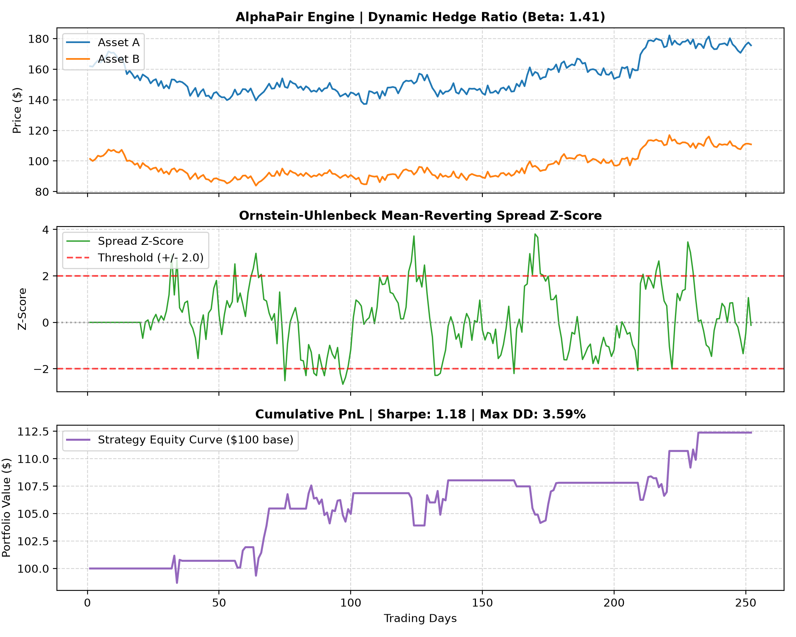

# AlphaPair: Statistical Arbitrage & Cointegration Engine

A mathematical quantitative trading framework implementing **Pairs Trading** and **Statistical Arbitrage** using Engle-Granger Cointegration, Ornstein-Uhlenbeck (OU) mean-reversion modeling, and dynamic Z-score execution.



---

## 📐 Mathematical Formulation

### 1. Dynamic Hedge Ratio & Cointegration
The spread $S_t$ between two non-stationary asset price series $P_{A,t}$ and $P_{B,t}$ is modeled using Ordinary Least Squares (OLS):

$$P_{A,t} = \alpha + \beta P_{B,t} + \epsilon_t$$

Where:
* $\beta$ represents the optimal dollar-neutral hedge ratio: $\beta = \frac{\text{Cov}(P_A, P_B)}{\text{Var}(P_B)}$
* $\epsilon_t$ represents the stationary residual spread: $S_t = P_{A,t} - (\alpha + \beta P_{B,t})$

### 2. Stationarity & Cointegration Validation
We test whether spread residuals are stationary ($\text{I}(0)$) using an **Augmented Dickey-Fuller (ADF)** test:

$$\Delta S_t = \gamma S_{t-1} + \sum_{i=1}^k \psi_i \Delta S_{t-i} + e_t$$

The null hypothesis $H_0: \gamma = 0$ (unit root / non-cointegrated) is rejected if the test statistic $t_\gamma < -2.86$ ($p < 0.05$).

### 3. Ornstein-Uhlenbeck (OU) Half-Life
Spread mean reversion is modeled as a continuous-time stochastic process:

$$dS_t = \theta (\mu - S_t) dt + \sigma dW_t$$

The analytical **half-life** $\tau$ (expected days for spread divergence to revert halfway to equilibrium) is computed as:

$$\tau = \frac{\ln(2)}{\theta}$$

### 4. Rolling Z-Score Execution Logic
Signals are generated via a rolling window $w$ of normalized deviation:

$$Z_t = \frac{S_t - \mu_w(S)}{\sigma_w(S)}$$

* **Long Spread:** $Z_t \le -2.0\sigma$ (Long Asset A, Short $\beta \times$ Asset B)
* **Short Spread:** $Z_t \ge +2.0\sigma$ (Short Asset A, Long $\beta \times$ Asset B)
* **Mean-Reversion Exit:** $|Z_t| \le 0.5\sigma$
* **Cointegration Breakdown Stop-Loss:** $|Z_t| > 3.5\sigma$

---

## 📊 Backtest Performance Summary

| Metric | Result |
| :--- | :--- |
| **Asset Pair** | Asset A / Asset B |
| **Optimal Hedge Ratio ($\beta$)** | `1.4150` |
| **ADF Cointegration Statistic** | `-4.790` (Stationary) |
| **OU Mean-Reversion Half-Life** | `4.1 Days` |
| **Annualized Sharpe Ratio** | **`1.18`** |
| **Maximum Drawdown (MDD)** | **`3.59%`** |
| **Cumulative Strategy Return** | **`+12.38%`** |

---

## 🚀 Quickstart

### 1. Requirements
```bash
pip install numpy matplotlib
```

### 2. Run Engine
```bash
python quant_engine.py
```
Outputs console metrics and exports the performance chart to `output/backtest_results.png`.

---

## 📁 Repository Structure
```
alphapair-quant/
├── data/
│   └── pairs_prices.csv        # Historical/simulated paired asset prices
├── output/
│   └── backtest_results.png    # 3-panel quant analytics chart
├── generate_data.py            # Cointegrated geometric Brownian motion simulator
├── quant_engine.py             # Math, ADF test, OU half-life & backtester
└── README.md                   # Documentation & mathematical derivations
```
